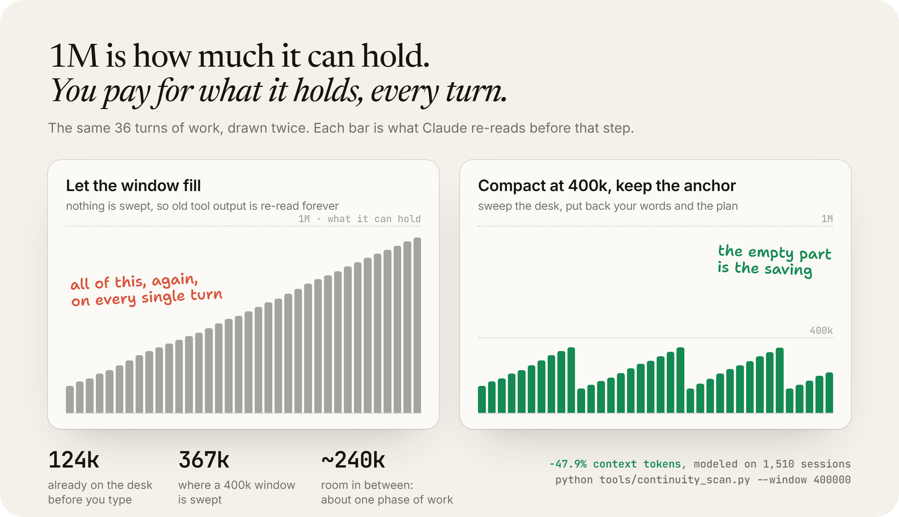

<picture>
  <source media="(prefers-color-scheme: dark)" srcset="figures/hero-dark.png">
  
</picture>

<p align="center">
  <a href="#the-numbers"></a>
  <a href="#the-numbers"></a>
  <a href="LICENSE"></a>
</p>

<p align="center"><b>Context discipline, continuity and first-pass orchestration for Claude Code.</b> Spend fewer tokens, keep your goal and your exact words alive across compaction, stop the model working from a guess, and land long work in one pass instead of three. Every number has a script.</p>

<p align="center">
  <a href="#install">Install</a> ·
  <a href="#the-problem-measured">The problem</a> ·
  <a href="#1m-is-the-size-of-the-desk-not-the-plan">Why 400k</a> ·
  <a href="#what-it-does">What it does</a> ·
  <a href="#how-a-session-runs">How a session runs</a> ·
  <a href="#fewer-invented-facts">Fewer invented facts</a> ·
  <a href="#the-numbers">Numbers</a> ·
  <a href="#measure-it-on-your-own-logs">Measure yours</a> ·
  <a href="#what-ordo-does-not-claim">Limits</a> ·
  <a href="#built-inside-kladds">Who built it</a>
</p>

<p align="center"><b><a href="https://app.kladds.com/d/waddt1eZWjWCng?utm_source=github&utm_medium=readme&utm_campaign=ordo">Read the full story: why Claude Code forgets what you told it, and the fix →</a></b></p>

<!-- REEL: when the ORDO reel is live, add one line here: "Watch the 60-second version" linking to it. -->

---

## Install

```bash
# Full: the skill + the continuity hooks (recommended)
/plugin marketplace add SprucetheAI/ordo   # then: /plugin install ordo@ordo (hooks wire themselves)
# or, without the plugin system:
npx github:SprucetheAI/ordo enforce --only continuity    # dry run: prints exactly what it would write
npx github:SprucetheAI/ordo enforce --only continuity --install

# Lean: the skill only, no hooks
npx github:SprucetheAI/ordo init --lean

# Prompt-only, any model: paste OPERATING-PROFILE.md (or the shorter CONTEXT-SAVER.md) into CLAUDE.md
```

Recommended with the hooks, if you run a 1M-context model: compact at 400k instead of letting the window fill.

```json
{ "env": { "CLAUDE_CODE_AUTO_COMPACT_WINDOW": "400000" } }
```

Why 400k when the model holds 1M: [the desk, explained](#1m-is-the-size-of-the-desk-not-the-plan). ORDO's nudges
follow whatever window you set (40%, 65%, 85% of it).

Node 18+. Nothing leaves your machine: state lives in `~/.ordo/` (override with `ORDO_HOME`).

## The problem, measured

Read off 1,510 real Claude Code sessions (Oct 1 to Nov 8, 2026), with the scripts in [`tools/`](tools/):

| | |
|---|---|
| Context carried by a typical request (median) | ~450k to 490k tokens |
| Where compaction fired (median) | 748k tokens |
| Distinctive words of the user's requests the summary kept | 46.5% |
| Requests kept verbatim | 8% |
| Rule sentences kept ("never…", "always…", "must…") | 37.4% |

Almost every token in an agentic session is the window being re-read, not your prompt and not the reply. And when
the window is finally compacted, the summary keeps less than half of what you asked for, so the model carries on
from a paraphrase. That reads as "it ignores my instructions" and "it forgot what we decided". It is not new: the
numbers are the same before and after the November 3 thinking change people are posting about
([`docs/OPUS-NOV-3.md`](docs/OPUS-NOV-3.md) has that story with the billed-token data).

## 1M is the size of the desk, not the plan

<picture>
  <source media="(prefers-color-scheme: dark)" srcset="figures/window-dark.png">
  
</picture>

Think of the context window as a desk. A 1M-token model has a very big desk. But before every single step, Claude
re-reads everything on that desk, and most of what piles up there is old tool output it will never need again. A
fuller desk does not make it smarter. It makes every step a longer re-read, and it buries what you said under what
a command printed two hours ago.

So ORDO works at 400k. When the desk is about 40% covered it gets swept, and the two things that matter go
straight back on it: the anchor (goal, plan, decisions, what failed) and your own words. You keep the big desk.
You stop re-reading the pile.

| Question | Answer |
|---|---|
| Is 400k too small for a 1M model? | No. 1M is what it *can* hold; you pay, in tokens and in attention, for what it *does* hold, on every turn |
| Then why not 200k? | A session is not empty when it starts. Ours measured 124k before the first tool call (system prompt, tool lists, CLAUDE.md, skill list), and Claude Code sweeps about 33k under the window. 400k leaves ~240k of room, about one phase of real work. Much lower and the session spends its time sweeping |
| When is a bigger window right? | When one thing has to be held whole: a very large single file or log, or one chain of reasoning that cannot be split into phases. Raise it for that session, then go back |
| And without ORDO's hooks? | Then a sweep costs you your own words (8% survive verbatim), and a bigger window is the safer default. The restore is what makes sweeping early cheap |

The picture is an illustration: both sides get the same inflow per turn. The 47.9% is modeled on the 1,510 real
sessions (`python tools/continuity_scan.py --window 400000`), not drawn from the picture.

## What it does

<picture>
  <source media="(prefers-color-scheme: dark)" srcset="figures/loop-dark.png">
  
</picture>

**1. Continuity, enforced by hooks** ([`hooks/ordo-continuity.mjs`](hooks/ordo-continuity.mjs), one file):

| Event | What ORDO does | Token cost |
|---|---|---|
| UserPromptSubmit | Saves your prompt verbatim to `~/.ordo/sessions/<id>/intent.jsonl`. On a long task, points the model at an anchor file to write first | 0, or ~60 once |
| PostToolUse | Reads the real context size from the transcript; at 40% / 65% / 85% of your compaction window, one nudge to update the anchor (silent if it is fresh). The last one is a cliff warning: land the unit, update the anchor, start no new large read | ~50 per band |
| PostToolUse | One line when a single tool result is ~15k tokens or more, because it is re-read on every later turn. At most twice per window | ~45, rarely |
| PreCompact | Gives the summarizer a contract: every request with done/open status, your constraints in your words, decisions, failed approaches, exact ids. A subagent's own compaction gets a smaller contract: its brief, its findings, its next step | summarizer input only |
| SessionStart (compact) | Puts back the anchor (head and tail when it is long, so NEXT, DECISIONS and FAILED survive), your requests verbatim (constraints first), and git state, under the 10k-char hook cap | ~2,300 per compaction |
| PostCompact | Audits how much of your words the summary kept into `~/.ordo/compactions.tsv` | 0 |
| SubagentStart | Return contract (answer first, at most 300 words, TSV rows, path:line, long output to a file, say what is missing instead of guessing) plus your goal line | ~100 per subagent |

The anchor is a plain file the model maintains: GOAL in your words, DONE-WHEN, PLAN, DONE with proof, NEXT,
DECISIONS (never re-litigated), FAILED (never retried). It is state, not a log: under ~3,500 characters, because
that is what comes back. The window can be thrown away; the anchor cannot.

**2. Context discipline** (the skill, [`skills/ordo/SKILL.md`](skills/ordo/SKILL.md)): read narrow, tail tool
output, machine output by shape (TSV, minified JSON, never pretty-printed), prose without preamble, fan out large
reading to subagents and keep only the conclusion. Bulk data goes file to file through a script, never through
the window.

**3. Verification on the cheapest surface that can fail.**

| What you are proving | Where | Evidence |
|---|---|---|
| Logic, data, parsing, API, tooling | Headless: a test or a one-off script | Last line of output |
| Page structure, text, console, network | Browser, accessibility snapshot; headless is fine | The values |
| Look: hierarchy, spacing, does it read | A real render, judged by eyes | The screenshot and a verdict |
| Motion, canvas, video playback | Headed window, requestAnimationFrame proven first | Frame timings |
| A video or audio file | Probe first, then watch only the cuts in question | Probe lines |

A test never signs off something a human sees; a screenshot never proves logic.

**4. The gates and the language** (opt-in): classify first, then refeed, diverge, evaluate or bound an autonomous
run only where it earns its cost ([`spec/`](spec/)). The compact command language is in [`ORDO.md`](ORDO.md).

ORDO removes waste, never thought. It does not shorten reasoning on a hard problem, trim a deliverable you asked
for, or narrow a creative search. It governs what surrounds the work: what gets read, what gets kept, what gets
checked.

## How a session runs

One pass to size the task, then the smallest process that fits it.

| Task | What ORDO does |
|---|---|
| Trivial: a lookup, a one-line answer | Nothing. The discipline would be pure overhead |
| Nimble: one defect, one file | Read narrow, fix, run the one check, report. No anchor |
| Long: many steps, many files, may outlive the window | Anchor before the first edit; updated at each phase and each nudge |
| Massive: a plan with phases, more than one window | The plan becomes a file with a status table. One phase per fresh context (a briefed subagent, or the main thread right after a compaction). The orchestrator holds the table and the verdicts, not the reading |

Everything has one home, so nothing sits in the window "in case": state in the anchor, the plan in its file,
history in commits, rules in docs that are grepped by heading, facts in memory. A phase ends when its check ran,
its status line flipped with the proof, and the anchor was updated. A status flips only with proof, and a skipped
step is written down as skipped, which is what stops the quiet lazy step in hour three.

## Fewer invented facts

In a long session the model rarely invents out of nowhere. It fills a gap, and the gaps have causes ORDO can close:

| Where the guess comes from | What closes it |
|---|---|
| It is working from a summary's paraphrase of what you asked | Your requests come back verbatim after every compaction, rule sentences first |
| It remembers a file that has since changed | After a compaction, re-read the anchor and the files you are about to edit before touching anything |
| It retries something that already failed, or reopens a settled choice | FAILED and DECISIONS live in the anchor and survive the window |
| A subagent filled a hole in its brief with an assumption | Briefs name goal, done-when, files and what is ruled out; the return contract says to name what is missing instead of guessing; the report is treated as a claim and the diff is checked |
| "Done" was said on a check that could not fail | Every "done" carries the last line of a real check; where none exists the answer is "untested" |
| A claim about code nobody read | A claim cites a line read or a command run in this window, or it is labelled unverified |

These are mechanisms, not a measured hallucination rate. What is measured is the first row: how much of what you
said is still in front of the model after a compaction.

## The numbers

<picture>
  <source media="(prefers-color-scheme: dark)" srcset="figures/numbers-dark.png">
  
</picture>

**Continuity**, replayed on 527 real compactions with the shipped restore code
(`python -I tools/continuity_scan.py` then `node tools/continuity_replay.mjs`):

| Kept after compaction | Summary alone | Summary + ORDO |
|---|---|---|
| Distinctive words of your requests | 46.5% | **70.3%** |
| Requests verbatim | 8.0% | **54.2%** |
| Rule sentences | 37.4% | **58.4%** |
| Cost | | ~2,300 tokens per compaction |

The restore's selection rule was picked by measurement, not taste: plain request openings, rules only, a hybrid,
and the shipped split were each replayed on the same 527 compactions ([`docs/CONTINUITY.md`](docs/CONTINUITY.md)).

**Window size** (modeled on the same sessions, assumptions in `continuity_scan.py`): compacting at 400k instead of
~1M processes **47.9% fewer context tokens** (133.0B → 69.3B), at the price of 1,102 extra compactions that the
restore makes cheap to survive.

**Token layers** on one synthetic structured turn, tiktoken o200k counts (`python tools/ab_smoke.py`):

| Layer | Without | With ORDO | Change |
|---|---|---|---|
| Output, tabular | 417 | 221 / 94 | −47% minified, −77% TSV |
| Output, verbosity | 58 | 17 | −71%, lossless |
| Inbound, structured | 729 | 225 | −69%, lossless |
| Inbound, prose | 54 | 41 | −24% |
| End-to-end turn | 819 | 260 | −68% |
| Tool output (crawl / transcript / PDF) | | | −62% / −46% / −24% (`tools/mcp_compact_ab.py`) |

The single biggest free win is still: never pretty-print JSON (−47%).

## Measure it on your own logs

```bash
python -I tools/continuity_scan.py --since 2026-10-01   # reads ~/.claude/projects, writes ~/.ordo/scan/
node tools/continuity_replay.mjs                        # summary alone vs summary + ORDO, on YOUR compactions
cat ~/.ordo/compactions.tsv                             # live audit, one row per compaction once the hooks run
```

The scan also writes billed thinking tokens per day and effort (`daily.tsv`), so you can check claims about the model
against your own usage instead of screenshots. Your prompt text stays in `~/.ordo/scan/`, never in the repo.

## What ORDO does NOT claim

- **It does not change the model.** It changes what the model is given: your words and its own anchor, after every compaction.
- **Recall is a proxy.** Keyword and verbatim recall measure what is still in the window, not whether the answer is right. A live headless A/B shows the hooks firing in a real session; at small scale both arms pass ([`docs/CONTINUITY.md`](docs/CONTINUITY.md)).
- **No hallucination rate.** The rules in [Fewer invented facts](#fewer-invented-facts) are mechanisms. We have not measured how often a model invents with and without them.
- **The anchor depends on the model writing it.** The hooks prompt it and put it back; they cannot write it for the model.
- **The restore is capped.** Claude Code caps hook output at 10,000 characters, so on sessions with hundreds of prompts the middle ones come back as one-line openings or rule sentences. The full log is on disk.
- **Not faster.** Each hook call costs ~150 ms of Node startup on Windows; there is no measured wall-clock win.
- **Not "fewest tokens, period".** A lossy compressor beats the lossless stack on raw count.
- Token numbers are GPT-tokenizer proxies; re-validate on your model (`python tools/tokenizer_robustness.py`).

Every claim with its evidence tier: [`BENCHMARKS.md`](BENCHMARKS.md) · [`VERDICT.md`](VERDICT.md).

## Built inside KLADDS

<a href="https://app.kladds.com/?utm_source=github&utm_medium=readme&utm_campaign=ordo">
<picture>
  <source media="(prefers-color-scheme: dark)" srcset="figures/kladds-dark.png">
  
</picture>
</a>

ORDO came out of building [KLADDS](https://app.kladds.com/?utm_source=github&utm_medium=readme&utm_campaign=ordo), the workspace we run our customers, mail, calls, content and comment-to-DM
automations in. The 1,510 sessions and 527 compactions measured above are KLADDS being built, mostly in sessions long
enough to compact several times. If you found ORDO through a comment and a DM, that funnel ran on KLADDS too.
The [full write-up of how ORDO came to be](https://app.kladds.com/d/waddt1eZWjWCng?utm_source=github&utm_medium=readme&utm_campaign=ordo) is a KLADDS splash page, built in the same workspace.

ORDO is the working method behind the product, given away. If it saved you one afternoon of an agent redoing its
own work, the thing that method was built to ship is where the rest of our time goes.

**[Get KLADDS free →](https://app.kladds.com/?utm_source=github&utm_medium=readme&utm_campaign=ordo)** Free forever plan, no card.

## Credits

Built on ideas from Headroom (inbound compaction), TOON (format by shape), LLMLingua (redundancy), Chroma's context-rot
work and Lost-in-the-Middle (why long windows decay), and Lojban (an unambiguous grammar). Their numbers are theirs;
ours are measured here.

MIT · [SprucetheAI](https://github.com/SprucetheAI) · Built inside [KLADDS](https://app.kladds.com/?utm_source=github&utm_medium=readme&utm_campaign=ordo_footer), the last business app you'll ever need
