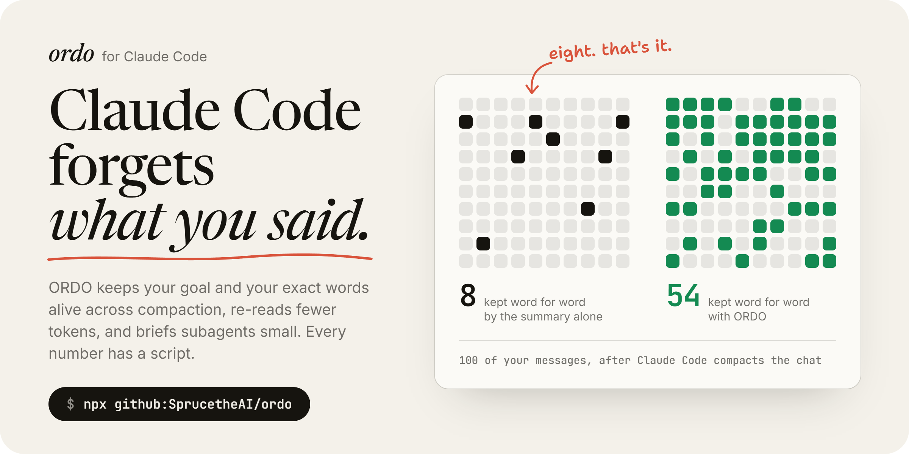
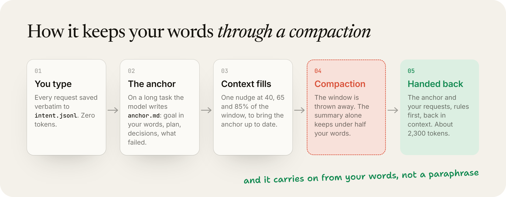
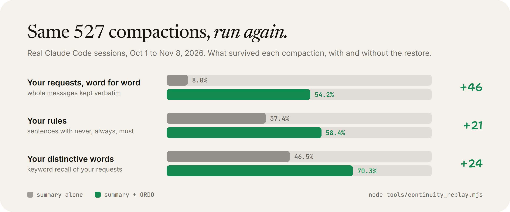
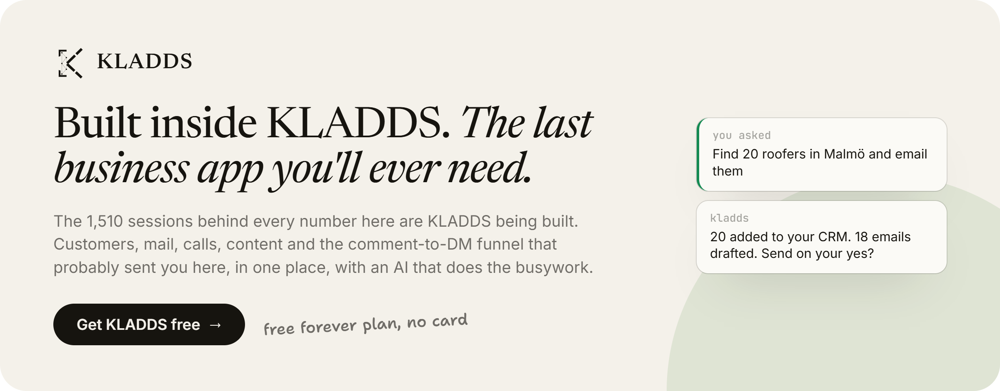

<picture>
  <source media="(prefers-color-scheme: dark)" srcset="figures/hero-dark.png">
  
</picture>

<p align="center">
  <a href="#the-numbers"></a>
  <a href="#the-numbers"></a>
  <a href="LICENSE"></a>
</p>

<p align="center"><b>Token discipline and long-session continuity for Claude Code.</b> Spend fewer tokens, keep your goal and your exact words alive across compaction, and keep subagents briefed with small returns. Every number has a script.</p>

<p align="center">
  <a href="#install">Install</a> ·
  <a href="#the-problem-measured">The problem</a> ·
  <a href="#what-it-does">What it does</a> ·
  <a href="#the-numbers">Numbers</a> ·
  <a href="#measure-it-on-your-own-logs">Measure yours</a> ·
  <a href="#what-ordo-does-not-claim">Limits</a> ·
  <a href="#built-inside-kladds">Who built it</a>
</p>

<p align="center"><b><a href="https://app.kladds.com/d/waddt1eZWjWCng?utm_source=github&utm_medium=readme&utm_campaign=ordo">Read the full story: why Claude Code forgets what you told it, and the fix →</a></b></p>

<!-- REEL: when the ORDO reel is live, add one line here: "Watch the 60-second version" linking to it. -->

---

## Install

```bash
# Full: the skill + the continuity hooks (recommended)
/plugin marketplace add SprucetheAI/ordo   # then: /plugin install ordo@ordo (hooks wire themselves)
# or, without the plugin system:
npx github:SprucetheAI/ordo enforce --only continuity    # dry run: prints exactly what it would write
npx github:SprucetheAI/ordo enforce --only continuity --install

# Lean: the skill only, no hooks
npx github:SprucetheAI/ordo init --lean

# Prompt-only, any model: paste OPERATING-PROFILE.md (or the shorter CONTEXT-SAVER.md) into CLAUDE.md
```

Recommended with the hooks, if you run a 1M-context model: compact at 400k instead of letting the window fill.

```json
{ "env": { "CLAUDE_CODE_AUTO_COMPACT_WINDOW": "400000" } }
```

Node 18+. Nothing leaves your machine: state lives in `~/.ordo/` (override with `ORDO_HOME`).

## The problem, measured

Read off 1,510 real Claude Code sessions (Oct 1 to Nov 8, 2026), with the scripts in [`tools/`](tools/):

| | |
|---|---|
| Context carried by a typical request (median) | ~450k to 490k tokens |
| Where compaction fired (median) | 748k tokens |
| Distinctive words of the user's requests the summary kept | 46.5% |
| Requests kept verbatim | 8% |
| Rule sentences kept ("never…", "always…", "must…") | 37.4% |

Almost every token in an agentic session is the window being re-read, not your prompt and not the reply. And when
the window is finally compacted, the summary keeps less than half of what you asked for, so the model carries on
from a paraphrase. That reads as "it ignores my instructions" and "it forgot what we decided". It is not new: the
numbers are the same before and after the November 3 thinking change people are posting about
([`docs/OPUS-NOV-3.md`](docs/OPUS-NOV-3.md) has that story with the billed-token data).

## What it does

<picture>
  <source media="(prefers-color-scheme: dark)" srcset="figures/loop-dark.png">
  
</picture>

**1. Continuity, enforced by hooks** ([`hooks/ordo-continuity.mjs`](hooks/ordo-continuity.mjs), one file):

| Event | What ORDO does | Token cost |
|---|---|---|
| UserPromptSubmit | Saves your prompt verbatim to `~/.ordo/sessions/<id>/intent.jsonl`. On a long task, points the model at an anchor file to write first | 0, or ~60 once |
| PostToolUse | Reads the real context size from the transcript; at 150k / 300k / 450k / 600k / 750k, one nudge to update the anchor (silent if the anchor is fresh) | ~50 per band |
| PreCompact | Gives the summarizer a contract: every request with done/open status, your constraints in your words, decisions, failed approaches, exact ids | summarizer input only |
| SessionStart (compact) | Puts back the anchor, your requests verbatim (constraints first), and git state, under the 10k-char hook cap | ~2,300 per compaction |
| PostCompact | Audits how much of your words the summary kept into `~/.ordo/compactions.tsv` | 0 |
| SubagentStart | Return contract (answer first, at most 300 words, TSV rows, path:line, long output to a file) plus your goal line | ~80 per subagent |

The anchor is a plain file the model maintains: GOAL in your words, PLAN, DONE with proof, NEXT, DECISIONS (never
re-litigated), FAILED (never retried). The window can be thrown away; the anchor cannot.

**2. Context discipline** (the skill, [`skills/ordo/SKILL.md`](skills/ordo/SKILL.md)): read narrow, tail tool
output, machine output by shape (TSV, minified JSON, never pretty-printed), prose without preamble, fan out large
reading to subagents and keep only the conclusion.

**3. Verification by surface**: headless tests for logic, data and backends (paste the last line); a real browser for
anything a human sees, accessibility snapshot first and screenshots only to judge pixels; a headed browser with a
requestAnimationFrame check for motion. A code test never signs off a user-facing feature.

**4. The gates and the language** (opt-in): classify first, then refeed, diverge, evaluate or bound an autonomous
run only where it earns its cost ([`spec/`](spec/)). The compact command language is in [`ORDO.md`](ORDO.md).

## The numbers

<picture>
  <source media="(prefers-color-scheme: dark)" srcset="figures/numbers-dark.png">
  
</picture>

**Continuity**, replayed on 527 real compactions with the shipped restore code
(`python -I tools/continuity_scan.py` then `node tools/continuity_replay.mjs`):

| Kept after compaction | Summary alone | Summary + ORDO |
|---|---|---|
| Distinctive words of your requests | 46.5% | **70.3%** |
| Requests verbatim | 8.0% | **54.2%** |
| Rule sentences | 37.4% | **58.4%** |
| Cost | | ~2,300 tokens per compaction |

The restore's selection rule was picked by measurement, not taste: plain request openings, rules only, a hybrid,
and the shipped split were each replayed on the same 527 compactions ([`docs/CONTINUITY.md`](docs/CONTINUITY.md)).

**Window size** (modeled on the same sessions, assumptions in `continuity_scan.py`): compacting at 400k instead of
~1M processes **47.9% fewer context tokens** (133.0B → 69.3B), at the price of 1,102 extra compactions that the
restore makes cheap to survive.

**Token layers** on one synthetic structured turn, tiktoken o200k counts (`python tools/ab_smoke.py`):

| Layer | Without | With ORDO | Change |
|---|---|---|---|
| Output, tabular | 417 | 221 / 94 | −47% minified, −77% TSV |
| Output, verbosity | 58 | 17 | −71%, lossless |
| Inbound, structured | 729 | 225 | −69%, lossless |
| Inbound, prose | 54 | 41 | −24% |
| End-to-end turn | 819 | 260 | −68% |
| Tool output (crawl / transcript / PDF) | | | −62% / −46% / −24% (`tools/mcp_compact_ab.py`) |

The single biggest free win is still: never pretty-print JSON (−47%).

## Measure it on your own logs

```bash
python -I tools/continuity_scan.py --since 2026-10-01   # reads ~/.claude/projects, writes ~/.ordo/scan/
node tools/continuity_replay.mjs                        # summary alone vs summary + ORDO, on YOUR compactions
cat ~/.ordo/compactions.tsv                             # live audit, one row per compaction once the hooks run
```

The scan also writes billed thinking tokens per day and effort (`daily.tsv`), so you can check claims about the model
against your own usage instead of screenshots. Your prompt text stays in `~/.ordo/scan/`, never in the repo.

## What ORDO does NOT claim

- **It does not change the model.** It changes what the model is given: your words and its own anchor, after every compaction.
- **Recall is a proxy.** Keyword and verbatim recall measure what is still in the window, not whether the answer is right. A live headless A/B shows the hooks firing in a real session; at small scale both arms pass ([`docs/CONTINUITY.md`](docs/CONTINUITY.md)).
- **The anchor depends on the model writing it.** The hooks prompt it and put it back; they cannot write it for the model.
- **The restore is capped.** Claude Code caps hook output at 10,000 characters, so on sessions with hundreds of prompts the middle ones come back as one-line openings or rule sentences. The full log is on disk.
- **Not faster.** Each hook call costs ~150 ms of Node startup on Windows; there is no measured wall-clock win.
- **Not "fewest tokens, period".** A lossy compressor beats the lossless stack on raw count.
- Token numbers are GPT-tokenizer proxies; re-validate on your model (`python tools/tokenizer_robustness.py`).

Every claim with its evidence tier: [`BENCHMARKS.md`](BENCHMARKS.md) · [`VERDICT.md`](VERDICT.md).

## Built inside KLADDS

<a href="https://app.kladds.com/?utm_source=github&utm_medium=readme&utm_campaign=ordo">
<picture>
  <source media="(prefers-color-scheme: dark)" srcset="figures/kladds-dark.png">
  
</picture>
</a>

ORDO came out of building [KLADDS](https://app.kladds.com/?utm_source=github&utm_medium=readme&utm_campaign=ordo), the workspace we run our customers, mail, calls, content and comment-to-DM
automations in. The 1,510 sessions and 527 compactions measured above are KLADDS being built, mostly in sessions long
enough to compact several times. If you found ORDO through a comment and a DM, that funnel ran on KLADDS too.
The [full write-up of how ORDO came to be](https://app.kladds.com/d/waddt1eZWjWCng?utm_source=github&utm_medium=readme&utm_campaign=ordo) is a KLADDS splash page, built in the same workspace.

**[Get KLADDS free →](https://app.kladds.com/?utm_source=github&utm_medium=readme&utm_campaign=ordo)** Free forever plan, no card.

## Credits

Built on ideas from Headroom (inbound compaction), TOON (format by shape), LLMLingua (redundancy), Chroma's context-rot
work and Lost-in-the-Middle (why long windows decay), and Lojban (an unambiguous grammar). Their numbers are theirs;
ours are measured here.

MIT · [SprucetheAI](https://github.com/SprucetheAI)
