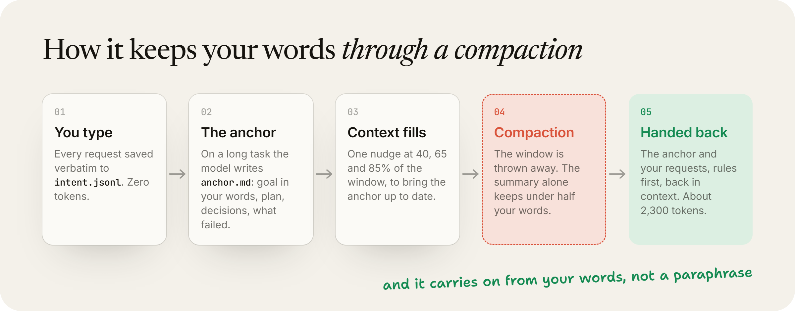
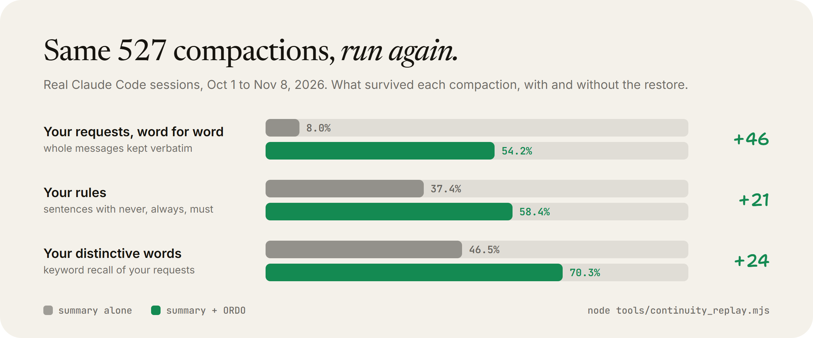

## What actually happens in a long session

Every time you send a message, Claude Code sends the whole conversation back to the model. Not the new message. All of it. Across 1,510 of my own sessions, a typical request carried somewhere between 450 and 490 thousand tokens of history.

When that window fills, Claude Code compacts it. The model writes a summary of everything so far, and the conversation is replaced with that summary. From then on, the summary is all it knows about what you asked for.

So I measured what the summary keeps. I took every compaction in my logs and checked the requests I had typed before it against the summary that came out of it.

- Of the distinctive words in my requests, **47%** survived.
- Of my requests, **8%** survived word for word.
- Of my rule sentences ("never", "always", "only", "don't"), **37%** survived.

```chart
{"type": "bar", "title": "What the compaction summary kept, on its own", "unit": "%", "caption": "527 real compactions, Oct 1 to Nov 8, 2026. Rerun it on your own logs with node tools/continuity_scan.py.", "labels": ["Distinctive words from your requests", "Requests kept word for word", "Your rule sentences"], "series": [{"name": "Summary alone", "values": [47, 8, 37]}]}
```

A median compaction happened at 748 thousand tokens and squeezed 37 of my requests into about 17,500 characters. When it "ignores your instructions" an hour in, it usually never saw them. It saw a paraphrase.

This is not the model getting worse. I checked that too: on my logs, thinking at high effort moved about 10%, inside normal day-to-day noise. The loss is the window, and it is the same on every effort level.

## How we chose to fix it

There were four obvious options, and three of them make it worse.

1. **A bigger window.** More history per turn means more tokens re-read every message and a bigger squeeze when it finally compacts.
2. **Better instructions to the summarizer.** We tried. It adopted our structure and ignored the instruction to end on a fixed line. You cannot rely on a summary to keep what you need.
3. **A memory database.** Another service to run, and it still has to decide what to fetch.
4. **Keep the user's words outside the window and hand them back.** Deterministic, no model change, nothing to host. This is what ORDO does, using the hooks Claude Code already has.

## How ORDO works

ORDO is one hook file plus a skill. It runs on six moments in a session.



1. **Your words, logged as you send them.** Every request you type is appended to a small log for the session, verbatim. The model never has to remember them.
2. **The anchor.** On a long task the model is pointed at one file and writes it before its first edit: the GOAL in your words, the PLAN, what is DONE with proof, what is NEXT, the DECISIONS you made, and what FAILED. Decisions are not re-argued and failed approaches are not retried.
3. **Before compaction.** A short contract tells the summarizer what must survive: your requests, your rules, the open work.
4. **After compaction.** ORDO puts a restore block straight back into the window: your first request, your last four, then your rule sentences and the openings of every other request, newest first, plus the anchor. About 2,300 tokens.
5. **Subagents.** Every subagent is briefed with a return contract, so it comes back with a conclusion instead of a file dump that eats your window.
6. **An audit.** Every compaction is logged with how much of your words the summary kept, so you can see the loss on your own machine.

Since v0.4 the reminders to update the anchor follow your window, at 40, 65 and 85% of it, and the last one says to finish the unit in hand and start no new large read. A long anchor comes back head and tail, so the next step, your decisions and the failed approaches survive a long list of finished work.

## Token efficiency, at the same time

Once your words survive compaction, compacting earlier stops being scary. ORDO sets the auto-compact window to 400 thousand tokens instead of letting it run toward a million. Why 400 thousand and not the full million has [its own tab](https://app.kladds.com/by/linus/why-claude-code-forgets-what-you-told-it-and-the-fix/why-400k).

Replaying my real sessions with that setting: **133 billion context tokens became 69 billion, 48% fewer**, at the cost of more frequent compactions. Most of those are cache reads, which are cheap per token, but they still count against your usage limits and they still sit in the model's attention.

```chart
{"type": "bar", "title": "Context tokens re-read, same sessions replayed", "unit": "billion tokens", "caption": "Auto-compact at 400k instead of near 1M. Modeled on my real sessions; more compactions, far less re-reading.", "labels": ["Default window", "ORDO, 400k window"], "series": [{"name": "Context tokens", "values": [133, 69]}]}
```

The skill adds the everyday habits: read files narrowly instead of whole, keep only the tail of long tool output, and hand machine data between agents as compact tables instead of pretty-printed JSON.

## The numbers

Replayed on 527 real compactions, summary alone against summary plus the ORDO restore:



| What survived | Summary alone | With ORDO |
|---|---|---|
| Distinctive words from your requests | 47% | 70% |
| Requests kept word for word | 8% | 54% |
| Your rule sentences | 37% | 58% |

Cost: about 2,300 tokens per compaction, and about 150 milliseconds per hook call.

## What it does not claim

Recall is a proxy. It measures whether your words are still visible, not whether the work comes out right. The numbers come from one heavy user's machine, not a population. A live head-to-head at 100 thousand tokens passed on both sides, because a short session summarizes fine; the loss shows at the scale the replay measures. The anchor is written by the model, so the hooks can prompt it and restore it but not author it. Every method and script is in the repo, so you can rerun it on your own logs.

## Install

Inside Claude Code:

```
/plugin marketplace add SprucetheAI/ordo
/plugin install ordo@ordo
```

Or without the plugin system:

```
npx github:SprucetheAI/ordo enforce --only continuity --install
```

## Where this page came from

You got here from a comment and a DM. The page, the reply and the DM all run on KLADDS, the workspace we build our content and automations in. If you want the same comment-to-DM setup on your own posts, that is what it is for.
